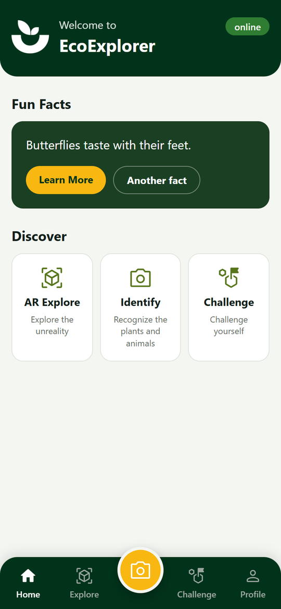
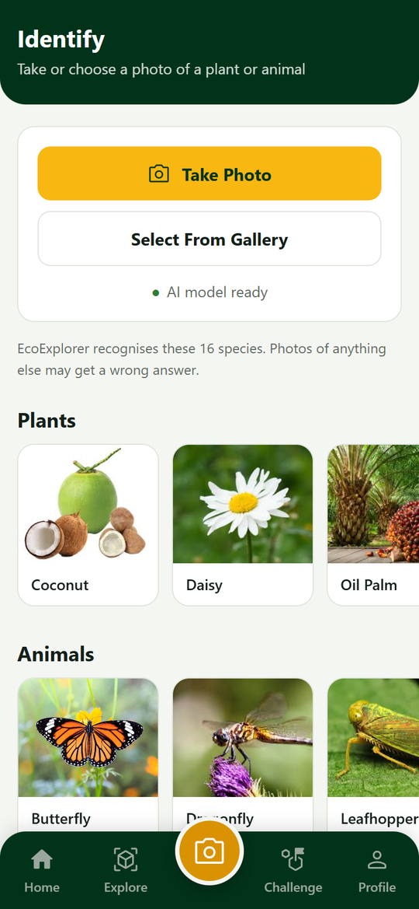
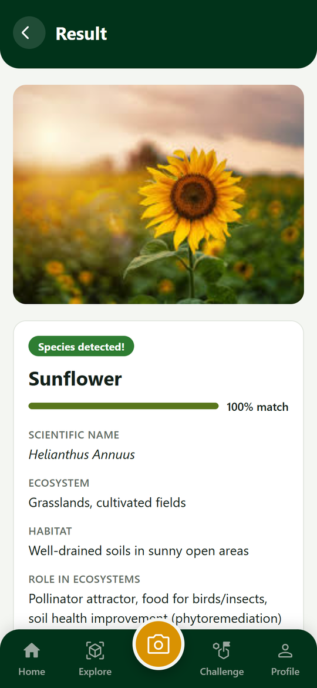
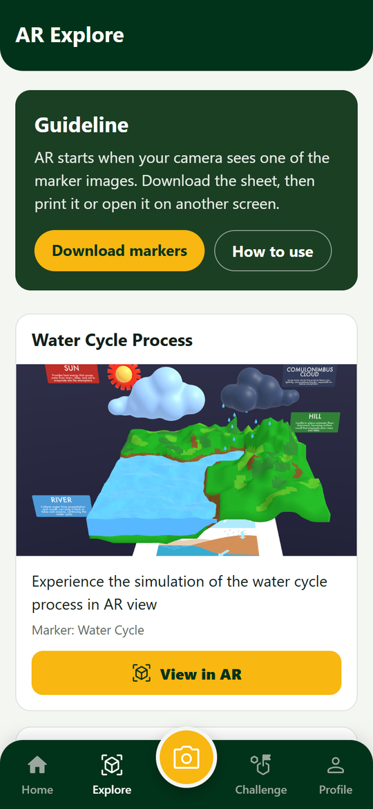
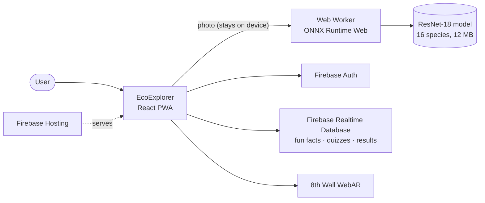

<p align="center">
  
</p>

<h1 align="center">EcoExplorer</h1>

<p align="center">
  <strong>Explore · Learn · Play</strong><br />
  Identify plants and insects with on-device AI, explore ecosystems in augmented reality, and test what you know with quizzes.
</p>

<p align="center">
  <a href="https://ecoexplorer-u2001264.web.app"><strong>Open the web app →</strong></a>
</p>

<p align="center">
  
  
  
  
</p>

---

## Overview

EcoExplorer is an educational app about local biodiversity. It began as a native **Android** app and has been rebuilt as a **web app (PWA)** that runs in any modern browser and can be installed on a phone's home screen. Both versions share the same Firebase backend, so accounts, quiz results and content are the same on each.

| | Android app | Web app |
|---|---|---|
| Folder | [`app/`](app/) | [`web/`](web/) |
| Stack | Java, Fragments, Navigation Component | React, TypeScript, Vite |
| AI model | PyTorch Mobile | ONNX Runtime Web (WebAssembly) |
| AR | 8th Wall inside a WebView | 8th Wall in the browser, with a QR code on desktop |
| Get it | Build with Android Studio | [ecoexplorer-u2001264.web.app](https://ecoexplorer-u2001264.web.app) |

## Features

- **Identify**: take or upload a photo and the AI names the species, with a confidence score, scientific name, ecosystem, habitat and role in the ecosystem. The model runs **entirely on the device**, so photos are never uploaded.
- **AR Explore**: point your camera at a printed marker to see a 3D water cycle simulation, or to learn about animals and plants in AR. The marker sheet can be downloaded from the app.
- **Challenge**: plant and animal quizzes, with your latest score saved to your account.
- **Fun facts**: a random nature fact on the home screen, with a link to its source.
- **Accounts**: sign up with email and password, reset a forgotten password, and set a profile picture. Guests can use everything except the quizzes.
- **Installable and works offline**: add it to your home screen like a native app. After the first use, the app and the AI model are cached, so Identify works without a connection. Fun facts, quizzes and AR still need the internet.
- **Light and dark mode**: follows your device setting.

### Species it recognises

| Plants (7) | Animals (9) |
|---|---|
| Coconut, Daisy, Oil Palm, Pinang (areca palm), Sunflower, Torch Ginger, Turmeric | Butterfly, Cicadas, Damselfly, Dragonfly, Leafhopper, Longhorn Beetle, Moths, Rhinoceros Beetle, Weevil |

## How it works



- **AI model**: a ResNet-18 image classifier trained with fastai on 16 local species. For the web, it was converted from PyTorch to ONNX and quantized to 8 bits, which made it 4× smaller (47 MB → 12 MB) with the same predictions on the test images. It runs in a Web Worker, so the page stays responsive.
- **Backend**: Firebase Authentication and Realtime Database, with security rules in [`database.rules.json`](database.rules.json). Everything runs on Firebase's free Spark plan, so profile pictures are resized in the browser and stored as small data URLs instead of in Cloud Storage.
- **AR**: built with [8th Wall](https://www.8thwall.com/) image targets and opened from the app.

## Project structure

```
EcoExplorer/
├── app/                  Android app (Java)
├── web/                  Web app (React + TypeScript + Vite)
│   ├── public/           Icons, images, AR marker sheet, ONNX model
│   └── src/
│       ├── pages/        Home, Explore, Identify, Challenge, Profile, auth screens
│       ├── components/   Layout, bottom nav, dialogs, QR code
│       ├── ml/           Classifier worker and image preprocessing
│       ├── lib/          Firebase data access (fun facts, quizzes, accounts)
│       └── data/         Species information
├── tools/                Model conversion and quantization, emulator seed data
├── docs/                 Migration plan and screenshots
├── firebase.json         Hosting, database rules and emulator config
└── database.rules.json   Realtime Database security rules
```

## Getting started

### Web app

You need [Node.js](https://nodejs.org/) 20.19+ (or 22.12+).

```bash
cd web
npm install
cp .env.example .env    # then fill in your Firebase web app config
npm run dev             # http://localhost:5173
```

The values for `.env` are in the Firebase console under **Project settings → General → Your apps → Web app**.

| Command | What it does |
|---|---|
| `npm run dev` | Start the dev server against the real Firebase project |
| `npm run dev:emulator` | Start the dev server against the local Firebase emulators |
| `npm run build` | Type-check and build the production app into `web/dist` |
| `npm run preview` | Serve the production build locally |

### Local testing with Firebase emulators

To try sign-up and quizzes without touching real data, run a local Auth and Database. This needs the [Firebase CLI](https://firebase.google.com/docs/cli) and Java.

```bash
firebase emulators:start --only "auth,database"   # terminal 1, repo root
node tools/seed-emulator.mjs                      # terminal 2: load quizzes and fun facts
cd web && npm run dev:emulator                    # terminal 3
```

The emulator UI is at http://127.0.0.1:4000. Data is wiped when the emulators stop.

### Deploy

```bash
cd web && npm run build
cd .. && firebase deploy --only hosting
```

### Android app

Open the repository root in Android Studio and run the `app` module. It needs Android 11 (API 30) or newer.

### AI model tools

The scripts in [`tools/`](tools/) rebuild the web model from the Android one. They need Python with PyTorch and ONNX Runtime; setup steps are in the [migration plan](docs/WEB_MIGRATION_PLAN.md).

```bash
python tools/convert_model.py    # app/src/main/assets/model.pt → tools/models/model.onnx
python tools/quantize_model.py   # → web/public/models/model.int8.onnx, then checks predictions match
```

## Known limitations

- The model only knows the 16 species above. Photos of anything else (other flowers, people, objects) can still get a confident but wrong answer. Retraining with an extra "other" class would fix this.
- AR needs a phone with a camera and the printed (or on-screen) marker. It depends on 8th Wall hosting.
- The first time Identify opens, it downloads about 16 MB (the model and the AI runtime). After that it's cached.

## Documentation

[`docs/WEB_MIGRATION_PLAN.md`](docs/WEB_MIGRATION_PLAN.md) covers the full Android-to-web migration: the original app's architecture, screen map and data model, the bugs that were fixed, how the AI model was converted, and each implementation phase.
