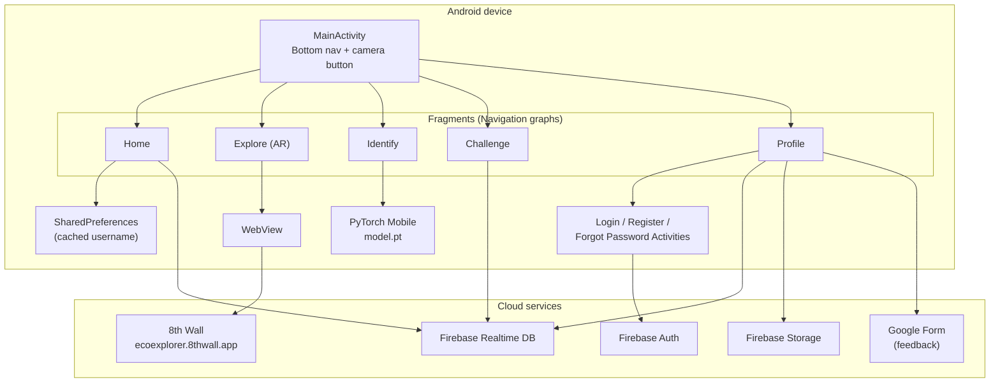
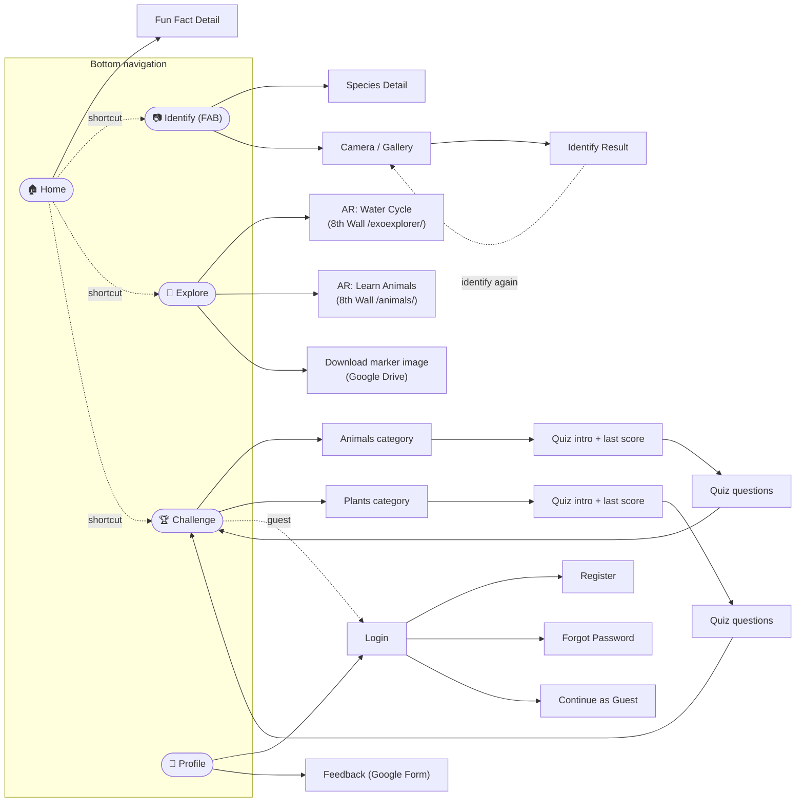
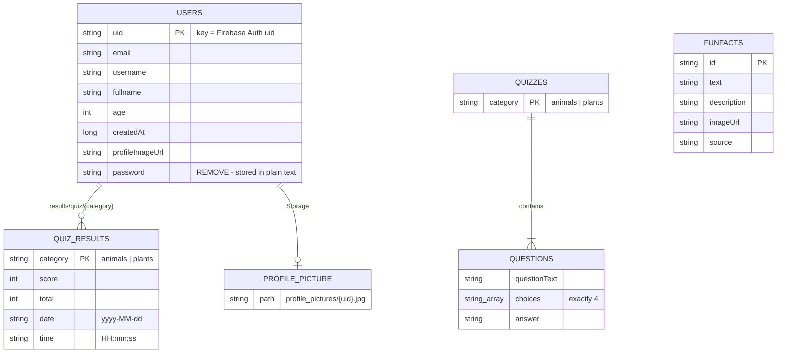
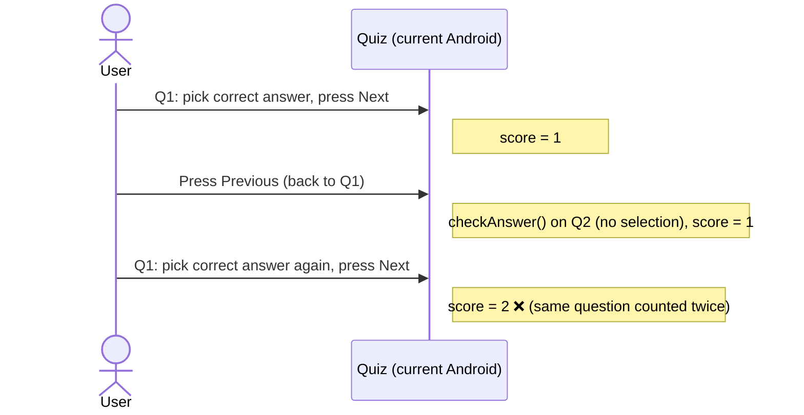
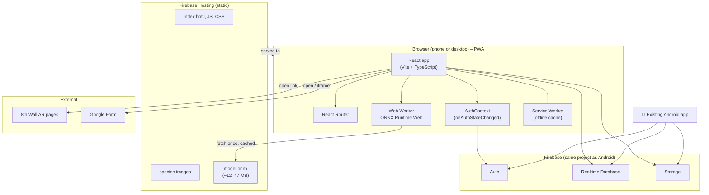
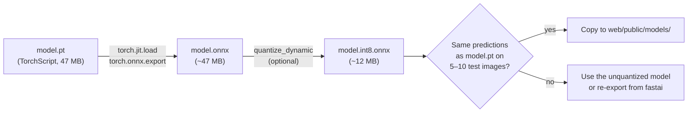
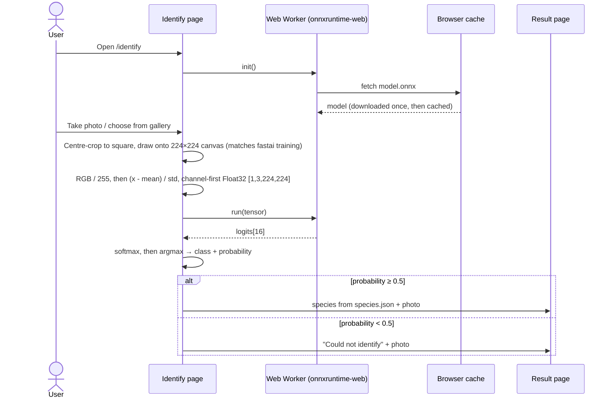
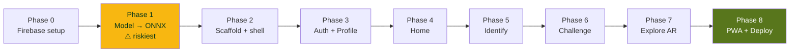
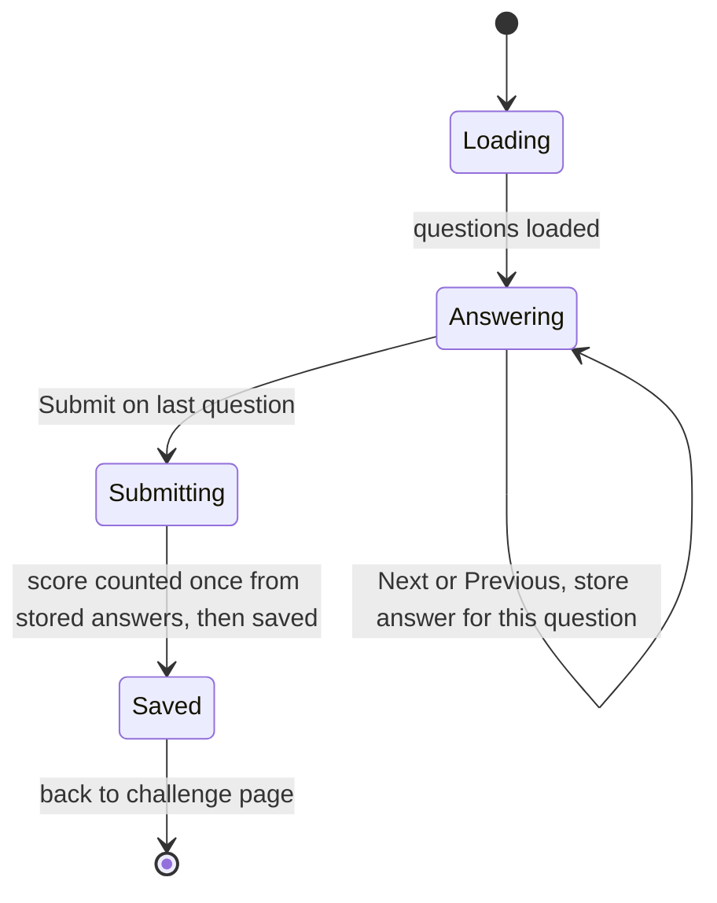

# EcoExplorer: Android to Web Migration Plan

> Reference document: project analysis plus the plan for turning the native Android app into a web app (PWA).
> Created: 2026-10-29

**Contents**
1. [Summary](#1-summary)
2. [Current project overview](#2-current-project-overview)
3. [Modules, classes and functions](#3-modules-classes-and-functions)
4. [Screen and navigation map](#4-screen-and-navigation-map)
5. [Firebase data model](#5-firebase-data-model)
6. [Dead code and bugs](#6-dead-code-and-bugs)
7. [Target web architecture](#7-target-web-architecture)
8. [Android to web mapping](#8-android-to-web-mapping)
9. [Identify (AI model) pipeline on the web](#9-identify-ai-model-pipeline-on-the-web)
10. [Implementation phases](#10-implementation-phases)
11. [Proposed web folder structure](#11-proposed-web-folder-structure)
12. [Risks and open questions](#12-risks-and-open-questions)

> **Viewing the diagrams:** they are written in [Mermaid](https://mermaid.js.org/). They render automatically on GitHub. In VS Code, install the *Markdown Preview Mermaid Support* extension and open the preview (`Ctrl+Shift+V`).

---

## 1. Summary

Converting the app to a web app is very doable, and most of it already runs on web technology:

| Part | Already web-ready? | Notes |
|---|---|---|
| Firebase (Auth, Realtime DB, Storage) | ✅ Yes | The JS SDK uses the same project and the same data |
| AR Explore (8th Wall) | ✅ Yes | Already web pages, currently loaded inside a WebView |
| Feedback | ✅ Yes | A Google Form |
| UI (Fragments / XML layouts) | ❌ Rewrite | Rebuild as React components |
| Species identification (`model.pt`) | ⚠️ Convert | PyTorch Mobile model → ONNX, run in the browser |

**Recommended stack:** React + Vite + TypeScript, Firebase JS SDK, ONNX Runtime Web, hosted on Firebase Hosting and set up as a PWA (installable web app).

---

## 2. Current project overview

| Item | Value |
|---|---|
| Language | Java 11 |
| UI | Single Activity + Fragments, Navigation Component, ViewBinding |
| Min / target SDK | 30 / 35 |
| Backend | Firebase project `ecoexplorer-u2001264` (Auth, Realtime Database, Storage) |
| AI | PyTorch Mobile, `assets/model.pt` (fastai ResNet, 16 classes, about 47 MB) |
| AR | 8th Wall WebAR (`ecoexplorer.8thwall.app`) inside a WebView |
| Images | Glide |
| Source size | 35 Java files, about 3,800 lines |

### Current architecture



---

## 3. Modules, classes and functions

Source root: `app/src/main/java/com/example/ecoexplorer/`

### 3.1 App shell

| Class | Responsibility | Key functions |
|---|---|---|
| [MainActivity](../app/src/main/java/com/example/ecoexplorer/MainActivity.java) | Bottom nav with 4 tabs plus a centre camera button (FAB) that jumps to Identify. Hides the nav on the camera, quiz and AR screens. Swaps the nav graph for each tab. | `onCreate()`, `switchToTab(tabID)` |
| [UserViewModel](../app/src/main/java/com/example/ecoexplorer/UserViewModel.java) | Shares the username across screens | `setUsername()`, `getUsername()` |
| [Utils](../app/src/main/java/com/example/ecoexplorer/Utils.java) | Copies an asset to the cache dir so PyTorch can load it | `assetFilePath()` |

### 3.2 Home module (`ui/home`)

| Class | Responsibility | Key functions |
|---|---|---|
| [HomeFragment](../app/src/main/java/com/example/ecoexplorer/ui/home/HomeFragment.java) | Greeting (guest or logged in), online/offline badge, random fun fact, shortcut cards to Identify / Explore / Challenge | `loadFunFacts()`, `learntMoreButton()`, `isConnected()`, `updateConnectionStatus()`, `connectionReceiver` |
| [FunFactsDetailFragment](../app/src/main/java/com/example/ecoexplorer/ui/home/FunFactsDetailFragment.java) | Full fun fact (text, description, image, source) | `onCreateView()` |
| [FunFacts](../app/src/main/java/com/example/ecoexplorer/ui/home/FunFacts.java) | Model: `text`, `description`, `imageUrl`, `source` | – |
| [UserUtils](../app/src/main/java/com/example/ecoexplorer/ui/home/UserUtils.java) | Username cache in SharedPreferences | `loadUsername()`, `getCachedUsername()`, `clearCachedUsername()` |
| HomeViewModel | *Unused* | – |

### 3.3 Identify module (`ui/identify`): the core feature

| Class | Responsibility | Key functions |
|---|---|---|
| [IdentifyFragment](../app/src/main/java/com/example/ecoexplorer/ui/identify/IdentifyFragment.java) | Hard-coded lists of 7 plants and 9 insects, camera/gallery picker, runs the AI model | `plantsData()`, `animalsData()`, `loadModel()`, `classifyImage()`, `processImageUri()`, `openCamera()`, `openGallery()` |
| [IdentifyResults](../app/src/main/java/com/example/ecoexplorer/ui/identify/IdentifyResults.java) | Shows the detected species if the score is ≥ 0.5, otherwise an error. "Identify again" offers camera or gallery | `showIdentifyResult()`, `identifyAgain()` |
| [DetailsFragment](../app/src/main/java/com/example/ecoexplorer/ui/identify/DetailsFragment.java) | Species detail page (from the lists) | `onCreateView()` |
| `Plants`, `Animals` | Model: name, description, scientific name, ecosystem, habitat, role, image | getters |
| `PlantsAdapter`, `AnimalsAdapter` | Horizontal RecyclerView lists | `onBindViewHolder()` |
| `OverlayView`, `ImageUtils` | *Unused* (old TFLite detection / CameraX code) | – |

**The 16 model classes:**

| Plants (7) | Insects (9) |
|---|---|
| Coconut, Daisy, Oil Palm, Pinang, Sunflower, Torch Ginger, Turmeric | Butterfly, Cicadas, Damselfly, Dragonfly, Leafhopper, Longhorn Beetle, Moths, Rhinoceros Beetle, Weevil |

### 3.4 Explore / AR module (`ui/explore`)

| Class | Responsibility | Key functions |
|---|---|---|
| [ExploreFragment](../app/src/main/java/com/example/ecoexplorer/ui/explore/ExploreFragment.java) | 2 AR cards plus a "Download marker image" button (Google Drive link) | `onCreateView()` |
| [WebARFragmentLearn](../app/src/main/java/com/example/ecoexplorer/ui/explore/WebARFragmentLearn.java) | WebView → `https://ecoexplorer.8thwall.app/animals/` | `loadWebAR()` |
| [WebARFragmentSimulation](../app/src/main/java/com/example/ecoexplorer/ui/explore/WebARFragmentSimulation.java) | WebView → `https://ecoexplorer.8thwall.app/exoexplorer/` (water cycle) | `loadWebAR()` |

### 3.5 Challenge module (`ui/challenge`)

| Class | Responsibility | Key functions |
|---|---|---|
| [ChallengeFragment](../app/src/main/java/com/example/ecoexplorer/ui/challenge/ChallengeFragment.java) | Choose a category (Animals or Plants), list of recent scores, login gate for guests | `displayRecentResults()`, `showNoAccountState()`, `showErrorState()` |
| `AnimalFragment` / `PlantFragment` | Category page → Quiz card | `onCreateView()` |
| `AnimalsChallengeQuiz` / `PlantsChallengeQuiz` | Quiz intro, last score, Start button | `loadRecentScore()` |
| [AnimalsQuizQuestions](../app/src/main/java/com/example/ecoexplorer/ui/challenge/animals/AnimalsQuizQuestions.java) / `PlantsQuizQuestions` | Loads `quizzes/{category}`, 4-option questions, Prev / Next / Submit, saves the score | `loadQuestions()`, `showQuestion()`, `checkAnswer()`, `checkAnswerAndNext()`, `previousAnswer()`, `checkAnswerAndSubmit()`, `saveScoreToUser()` |
| `AnimalsQuiz` / `PlantsQuiz` | Model: `questionText`, `choices`, `answer` | getters |
| `Results`, `ResultsAdapter` | Model + list of `quizName`, `score` | – |
| ChallengeViewModel | *Unused* | – |

> Plants and Animals are about 95% duplicate code. Only the category string and the IDs differ.

### 3.6 Profile and auth module (`ui/profile`)

| Class | Responsibility | Key functions |
|---|---|---|
| [ProfileFragment](../app/src/main/java/com/example/ecoexplorer/ui/profile/ProfileFragment.java) | User info, profile picture upload, logout, link to feedback, guest view | `loadUserInfo()`, `openFileChooser()`, `uploadImageToFirebase()` |
| [LoginActivity](../app/src/main/java/com/example/ecoexplorer/ui/profile/LoginActivity.java) | Email/password login, guest login, links to Register and Forgot | `loginUser()` |
| [RegisterActivity](../app/src/main/java/com/example/ecoexplorer/ui/profile/RegisterActivity.java) | Register with email, password, username, full name, age | `registerUser()` |
| [ForgotPasswordActivity](../app/src/main/java/com/example/ecoexplorer/ui/profile/ForgotPasswordActivity.java) | Sends a Firebase password reset email | `setupSendResetEmail()` |
| [Feedback](../app/src/main/java/com/example/ecoexplorer/ui/profile/Feedback.java) | Google Form in a WebView | `loadFeedbackForm()` |

---

## 4. Screen and navigation map



---

## 5. Firebase data model

The web app reuses this exactly, so Android and web users share the same accounts and scores.



Database tree:

```
(root)
├── funfacts/{id}                      → text, description, imageUrl, source
├── quizzes/
│   ├── animals/{id}                   → questionText, choices[4], answer
│   └── plants/{id}                    → questionText, choices[4], answer
└── users/{uid}                        → email, username, fullname, age, createdAt, profileImageUrl, password ⚠
    └── results/quiz/{animals|plants}  → score, total, date, time

Storage: profile_pictures/{uid}.jpg
```

---

## 6. Dead code and bugs

### 6.1 Dead code (do not port)

| Item | Why |
|---|---|
| `assets/fruits.tflite`, `insects.tflite`, `mobilenet.tflite`, `mobilenet_label.txt` (about 15 MB) | Only `model.pt` is used |
| `OverlayView`, `ImageUtils`, `loadModelFile()`, `loadLabels()` | Leftover TFLite/CameraX code |
| `HomeViewModel`, `ChallengeViewModel` | Never used |
| TFLite, CameraX, Google Sign-In and Glide dependencies | Not needed on the web |

### 6.2 Bugs to fix during the port

| # | Severity | Bug | Location | Web fix |
|---|---|---|---|---|
| 0 | 🔴 Critical | **Database rules allow anyone to read `/users`** without logging in (found 2026-10-30). Combined with bug 1, every user's email and password is exposed | Firebase console rules | Deploy [database.rules.json](../database.rules.json) (Phase 0) |
| 1 | 🔴 High | **Passwords are saved in plain text** to `users/{uid}/password` | [RegisterActivity.java:674](../app/src/main/java/com/example/ecoexplorer/ui/profile/RegisterActivity.java#L674), [LoginActivity.java:330](../app/src/main/java/com/example/ecoexplorer/ui/profile/LoginActivity.java#L330) | Don't write it, delete the existing values, rely on Firebase Auth |
| 2 | 🟠 Medium | **Quiz score is double-counted.** `checkAnswer()` runs on both Next and Previous | `*QuizQuestions.checkAnswer()` | Store answers in an array and calculate the score once at submit |
| 3 | 🟠 Medium | **Username uniqueness check doesn't work.** It checks `users/{username}`, but data is keyed by uid | [RegisterActivity.java:657](../app/src/main/java/com/example/ecoexplorer/ui/profile/RegisterActivity.java#L657) | Add a `usernames/{username} → uid` index |
| 4 | 🟠 Medium | **0.5 confidence threshold uses raw logits**; no softmax is applied | [IdentifyResults.java](../app/src/main/java/com/example/ecoexplorer/ui/identify/IdentifyResults.java) | Apply softmax, then compare the probability |
| 5 | 🟡 Low | **Logout doesn't clear the cached username** (wrong prefs name/key) | [UserUtils.java:40](../app/src/main/java/com/example/ecoexplorer/ui/home/UserUtils.java#L40) | Username comes from auth state, no separate cache |
| 6 | 🟡 Low | Plants and Animals quiz code is duplicated | `ui/challenge/animals`, `ui/challenge/plants` | One `<Quiz category>` component |
| 7 | 🟡 Low | Species data is duplicated (`SPECIES_INFO` plus the list data) | `IdentifyFragment` | One `species.json` |
| 8 | 🟠 Medium | **Photo is stretched to 224×224**, but the model was trained on centre-cropped images (fastai `Resize(224)`) | `IdentifyFragment.classifyImage()` | Centre-crop, then resize |

**Bug 2, illustrated:**



---

## 7. Target web architecture



**Why this design:**
- **No server to maintain:** the AI runs in the browser and hosting is static and free.
- **Same Firebase project:** existing users, quizzes, fun facts and scores work unchanged, and Android and web share them.
- **PWA:** it can be installed on phones from the browser, so it still feels like an app for showcasing.
- **The Android code is untouched:** the web app lives in a new `web/` folder in this repo.

---

## 8. Android to web mapping

| Android concept | Web replacement |
|---|---|
| `Activity` / `Fragment` | React page component |
| Navigation XML graphs | React Router routes (see below) |
| `BottomNavigationView` + FAB | `<BottomNav>` layout component |
| XML layouts + `colors.xml` | CSS (variables from `colors.xml`) |
| `ViewModel` + `LiveData` | React state / context |
| `SharedPreferences` (username) | `AuthContext` + `users/{uid}` profile |
| Firebase Android SDK | Firebase JS SDK (modular v10+) |
| PyTorch Mobile (`model.pt`) | ONNX Runtime Web (`model.onnx`) in a Web Worker |
| Camera / gallery `Intent` | `<input type="file" accept="image/*" capture="environment">` |
| `ConnectivityManager` receiver | `navigator.onLine` + `online` / `offline` events |
| `Glide` | `` |
| `Toast` / `AlertDialog` | Toast component / `<dialog>` |
| WebView (8th Wall) | Open the URL directly (new tab) |
| WebView (Google Form) | Link or `<iframe>` |
| `R.drawable.identify_*` | `public/images/species/*.jpg` |

### Route map

| Route | Replaces | Login required |
|---|---|---|
| `/` | HomeFragment | – |
| `/funfacts/:id` | FunFactsDetailFragment | – |
| `/explore` | ExploreFragment | – |
| `/identify` | IdentifyFragment | – |
| `/identify/result` | IdentifyResults | – |
| `/species/:id` | DetailsFragment | – |
| `/challenge` | ChallengeFragment | – |
| `/challenge/:category` | AnimalFragment / PlantFragment + *ChallengeQuiz | ✅ |
| `/challenge/:category/quiz` | AnimalsQuizQuestions / PlantsQuizQuestions | ✅ |
| `/profile` | ProfileFragment | – (guest view) |
| `/login`, `/register`, `/forgot-password` | Login / Register / ForgotPassword Activities | – |

---

## 9. Identify (AI model) pipeline on the web

### 9.1 One-time model conversion (Python, on your PC)



Draft conversion script (`tools/convert_model.py`):

```python
import torch

model = torch.jit.load("app/src/main/assets/model.pt", map_location="cpu")
model.eval()

dummy = torch.randn(1, 3, 224, 224)
torch.onnx.export(
    model, dummy, "web/public/models/model.onnx",
    input_names=["input"], output_names=["logits"],
    opset_version=17,
)

# Optional: shrink to about a quarter of the size
from onnxruntime.quantization import quantize_dynamic, QuantType
quantize_dynamic("web/public/models/model.onnx",
                 "web/public/models/model.int8.onnx",
                 weight_type=QuantType.QUInt8)
```

### 9.2 Runtime flow in the browser



The preprocessing must match **how the model was trained** (fastai notebook), not the Android code:

| Step | Value |
|---|---|
| Resize | **Centre-crop to a square, then resize to 224 × 224** (fastai `Resize(224)` default). Android stretches with `Bitmap.createScaledBitmap`, which differs from training and can lower accuracy on non-square photos |
| Mean (RGB) | `[0.485, 0.456, 0.406]` |
| Std (RGB) | `[0.229, 0.224, 0.225]` |
| Layout | NCHW float32 |
| Label order | `Butterfly, Cicadas, Coconut, Daisy, Damselfly, Dragonfly, Leafhopper, Longhorn Beetle, Moths, Oil Palm, Pinang, Rhinoceros Beetle, Sunflower, Torch Ginger, Turmeric, Weevil` |

---

## 10. Implementation phases



### Phase 0: Firebase setup
- [x] Register a **Web app** in Firebase project `ecoexplorer-u2001264` and copy its config into `web/.env` (done 2026-10-30; `.env` is git-ignored)
- [ ] Add the hosting domain(s) to **Auth → Settings → Authorized domains** (`localhost` works by default)
- [ ] ⚠️ **Urgent: the live database is currently publicly readable.** On 2026-10-30, unauthenticated reads of `/users`, `/funfacts` and `/quizzes` all returned HTTP 200, so anyone with the database URL (it's inside the APK) can download every user's email and plain-text password.
- [ ] Deploy the prepared rules: [database.rules.json](../database.rules.json) and [storage.rules](../storage.rules). After `firebase login --reauth`, run `firebase deploy --only database,storage`, or paste them into the console. First compare them with the rules currently in the console.
  - Owners only can read and write `users/{uid}`. Reading a key that **doesn't exist** stays allowed, so the Android app's existing username check (`users/{username}`, made before login) keeps working.
  - `funfacts` and `quizzes` are public read-only. The new `usernames/{name} → uid` index is public read and claim-once.
  - Storage: anyone can read profile pictures; only the owner can write `profile_pictures/{uid}.jpg` (image, under 5 MB).
- [ ] Delete the existing `users/*/password` values. Then update the Android `LoginActivity` and `RegisterActivity` to stop writing them, and add a rule that blocks `password` writes.
- [ ] Optional: backfill `usernames/` for existing users, so the web uniqueness check also covers accounts created on Android.

Example rules (the deployed version is in `database.rules.json`):
  ```json
  {
    "rules": {
      "funfacts": { ".read": true, ".write": false },
      "quizzes":  { ".read": true, ".write": false },
      "users": {
        "$uid": { ".read": "auth.uid === $uid", ".write": "auth.uid === $uid" }
      }
    }
  }
  ```
- [ ] Review the Storage rules: `profile_pictures/{uid}.jpg` writable only by that uid

### Phase 1: Model conversion ✅ (done 2026-10-29)
- [x] Convert `model.pt` to ONNX with [tools/convert_model.py](../tools/convert_model.py) → `web/public/models/model.onnx` (44.7 MB, opset 17, input `[1,3,224,224]`, output `logits [1,16]`; only standard ops, all supported by onnxruntime-web)
- [ ] Optionally quantize to about 12 MB (deferred to Phase 8; needs calibration images from the Drive dataset)
- [x] Predictions match: identical top-1 on 19 test images, max logit difference 6e-5. All 17 in-class images were classified correctly (they may be training images, so this isn't a true accuracy figure)
- [x] Decide whether the model outputs logits or probabilities: **logits** (no softmax in `model.pt`), so the web app must apply softmax

### Phase 2: Scaffold and app shell ✅ (done 2026-10-29)
- [x] Vite 8 + React 19 + TypeScript 7 project in `web/`
- [x] Added `react-router-dom` 7, `firebase` 13, `onnxruntime-web` 1.31
- [x] Layout: phone-width column (max 480 px, centred on desktop), `<BottomNav>` with the centre camera button, nav hidden on the quiz and auth screens, `<PageHeader>` with back arrow
- [x] Theme tokens from `colors.xml`, with dark mode from the night colours (follows the system setting)
- [x] Icons converted from the Android vector drawables; app icons (192/512/maskable/Apple) and `logo.svg` generated from the mipmaps and `ecoecplorer_full_logo.xml`
- [x] Images copied to `web/public/images/species/` (16, renamed by species) and `web/public/images/ar/`
- [x] Every route from §8 exists, with a placeholder page that says which phase builds it
- [x] `web/.env.example` with the Firebase values known from `google-services.json` (API key and App ID still needed, see Phase 0)
- [x] Verified: `npm run build` passes; at 390 px wide there's no horizontal overflow in light or dark mode; tabs, active state and the camera button navigate correctly

**Run it:**
```
cd web
npm install        # first time only
npm run dev        # http://localhost:5173
npm run build      # production build into web/dist
```

### Phase 3: Auth and Profile ✅ (done 2026-10-30)
- [x] `src/firebase.ts` (config from `.env`) and `AuthContext` (user, live `users/{uid}` profile, loading)
- [x] `/login`, `/register`, `/forgot-password`, "Continue as Guest". After login or register, the user goes back to the page that sent them (`state.from`)
- [x] `/profile`: guest view with a sign-in card; logged-in view with info, profile picture upload to Storage, Help & Feedback and Log out
- [x] `/feedback`: the Google Form embedded, with an "open in new tab" fallback
- [x] Bug 1: the web app never writes passwords to the database
- [x] Bug 3: `usernames/{name}` index; it degrades gracefully until the rules are deployed
- [x] Bug 5: there's no separate username cache; it comes from the auth state
- [x] Verified in Edge at 390 px, light and dark: guest profile, login (a wrong password shows "Incorrect email or password." from real Firebase Auth), register validation, forgot password, the feedback form loads. No unexpected console errors
- [ ] **Not yet tested:** the logged-in profile and picture upload, and a real registration (needs a real account; not done, to avoid writing test data to the live database)

### Phase 4: Home ✅ (done 2026-10-30)
- [x] Greeting: guest sees "Welcome to EcoExplorer" with the leaf mark; logged-in users see "Welcome, {username}" with their picture
- [x] Online/offline badge that updates live (`navigator.onLine` events)
- [x] Random fun fact from `/funfacts` (7 facts) with **Learn More** → `/funfacts/:id`, plus an extra **Another fact** button
- [x] The fact detail page loads by id, so shared links work. Unknown ids show "doesn't exist". Source links show the website name
- [x] Discover cards (AR Explore, Identify, Challenge), same wording as `home.xml`
- [x] Shared `<Avatar>`: falls back to the person icon if a picture is missing or fails to load. Broken fact images are hidden
- [x] Verified in Edge at 390 px, light and dark: fact loads and changes, Learn More and Back, offline/online toggle, all 3 cards navigate, no overflow
- ⚠️ Fact 01's image doesn't load: Firebase Storage returns HTTP 402 (see Risks). The image also shows a beetle (`categories/beetle.jpeg`) for a butterfly fact

### Phase 5: Identify
- [ ] `species.json` holding all 16 species (fixes bug 7)
- [ ] Plant and insect carousels, plus `/species/:id`
- [ ] Image capture/upload, Web Worker inference, `/identify/result`
- [ ] Load the model only when Identify is first opened; show a loading/progress state

### Phase 6: Challenge
- [ ] `/challenge`: categories and recent results (`users/{uid}/results/quiz`)
- [ ] `/challenge/:category`: intro and last score
- [ ] `/challenge/:category/quiz`: one generic `<Quiz>` component (fixes bugs 2 and 6)
- [ ] Save `{score, total, date, time}` in the same format as Android

### Phase 7: Explore (AR)
- [ ] Two AR cards that open the 8th Wall URLs
- [ ] Marker image download and a "how to use" dialog
- [ ] On desktop, show a QR code: "Scan to open on your phone"

### Phase 8: PWA and deploy
- [ ] `vite-plugin-pwa`: manifest, icons (from `mipmap-*`), offline cache for the app files and the model
- [ ] `firebase init hosting` (public dir `web/dist`, SPA rewrite to `/index.html`)
- [ ] `npm run build && firebase deploy --only hosting`
- [ ] Live at `https://ecoexplorer-u2001264.web.app`

### Quiz design (fixes bug 2)



---

## 11. Proposed web folder structure

```
EcoExplorer/
├── app/                         ← existing Android app (unchanged)
├── docs/
│   └── WEB_MIGRATION_PLAN.md    ← this file
├── tools/
│   └── convert_model.py         ← model.pt → model.onnx
├── firebase.json                ← hosting config
└── web/
    ├── index.html
    ├── vite.config.ts
    ├── .env                     ← Firebase web config (VITE_FIREBASE_*)
    ├── public/
    │   ├── models/model.onnx
    │   ├── images/species/*.jpg
    │   └── icons/
    └── src/
        ├── main.tsx
        ├── App.tsx              ← routes
        ├── firebase.ts          ← initializeApp, auth, db, storage
        ├── theme.css            ← colour tokens from colors.xml
        ├── context/
        │   └── AuthContext.tsx
        ├── components/
        │   ├── BottomNav.tsx
        │   ├── SpeciesCard.tsx
        │   └── Quiz.tsx
        ├── data/
        │   └── species.json     ← 16 species (replaces SPECIES_INFO + lists)
        ├── ml/
        │   ├── classifier.worker.ts
        │   └── preprocess.ts
        └── pages/
            ├── Home.tsx, FunFactDetail.tsx
            ├── Explore.tsx
            ├── Identify.tsx, IdentifyResult.tsx, SpeciesDetail.tsx
            ├── Challenge.tsx, ChallengeCategory.tsx, QuizPage.tsx
            ├── Profile.tsx, Feedback.tsx
            └── Login.tsx, Register.tsx, ForgotPassword.tsx
```

---

## 12. Risks and open questions

| Risk | Impact | Mitigation |
|---|---|---|
| **8th Wall shutdown.** 8th Wall announced in 2025 that the platform is being discontinued. | AR module may stop working | Check that `ecoexplorer.8thwall.app` still works. Alternatives: MindAR (image-tracking WebAR), or a `<model-viewer>` 3D view without AR |
| **TorchScript → ONNX export fails** | Identify blocked | Re-export from the original fastai notebook, or run the model on a small Python server (FastAPI) |
| **Firebase Storage is unavailable.** Since 2026, Google returns HTTP 402 *"Cloud Storage for Firebase no longer supports Firebase projects that are on the no-cost Spark pricing plan"* for the default `*.firebasestorage.app` bucket (found 2026-10-30) | Profile pictures (upload and display, **on Android too**) and the fun-fact image don't work | Option A: upgrade to the **Blaze** plan (pay-as-you-go; needs a billing card; Storage keeps a no-cost quota). Option B (free): store a small resized profile picture (about 256 px JPEG, under 30 KB) as a data URL in `users/{uid}/profileImageUrl` (Glide on Android can display data URLs too), and serve fun-fact images from Firebase Hosting |
| **Model is overconfident on unknown species.** `rose.jpg` and `tulip.jpg` (not among the 16 classes) were both predicted as *Torch Ginger* with 100% probability | The "could not identify" message will almost never appear, so users get confident wrong answers | Short term: state on the Identify page which 16 species it recognises. Long term: retrain with an extra "other" class (dataset is on Drive) |
| **Model download size** (12–47 MB) | Slow first use of Identify | Quantize; load only when Identify is first opened; cached by the Service Worker after that |
| **Camera on desktop** | No `capture` support | Falls back to the file picker (fine for a showcase) |
| **Firebase config is public on the web** | Anyone can call the DB | Normal for Firebase; security comes from the **rules** (Phase 0) |

### Questions answered (2026-10-29)
1. **Python / PyTorch:** Node v24.12.0, npm 11.19.0 and the Firebase CLI are installed.
   - Installing PyTorch into the Microsoft Store Python 3.11 **fails**: its package folder path is so long that a PyTorch file exceeds Windows' 260-character path limit.
   - **Solution used:** a virtual environment at the short path `tools/.venv` (git-ignored). It has torch 2.15.0+cpu, onnx 1.23.2, onnxruntime 1.31.1, onnxscript, numpy and Pillow. To recreate it:
     ```
     python -m venv tools\.venv
     tools\.venv\Scripts\python.exe -m pip install torch --index-url https://download.pytorch.org/whl/cpu
     tools\.venv\Scripts\python.exe -m pip install onnx onnxruntime onnxscript numpy pillow
     ```
2. **fastai notebook:** none found on this PC (searched Documents, Downloads, Desktop, OneDrive, `C:\laragon\www`). **It isn't needed.** Inspecting `model.pt` shows:
   - It's a **traced TorchScript** model: a torchvision ResNet body plus the standard fastai head (AdaptiveConcatPool2d → Flatten → BatchNorm1d → Dropout → Linear → ReLU → BatchNorm1d → Dropout → Linear).
   - Everything is self-contained, so `torch.jit.load` works **without fastai installed**, and traced models usually export to ONNX cleanly.
   - There's **no softmax**: the model outputs raw logits. This confirms bug 4.
   - **Update: notebook found** in the shared Drive folder ([Colab Notebooks](https://drive.google.com/drive/folders/15GjQr70qw9IRF9cie18s0JoNfAw-OIb5)) as *"EcoExplorer - Image Classification CNN"*. Key facts:
     - **Training setup:** fastai `cnn_learner(dls, resnet18)`, `fit_one_cycle(40, slice(1e-3, 1e-1))`, 1,095 training and 273 validation images (20% split of `image_classify/train`, seed 40).
     - **Class order:** `dls.vocab` is alphabetical and matches `CLASS_LABELS` in the Android app, so the label mapping is correct.
     - **How `model.pt` was made:** `load_learner("trained/export.pkl")` → `torch.jit.trace` → `model.pt`. `export.pkl` and `stage-1.pth` were saved in the `trained` folder.
     - **Preprocessing:** `Resize(224)` uses fastai's default **crop** method (centre-crop at inference). Android **stretches** the photo instead, which doesn't match training. The web app will centre-crop.
     - **Normalisation:** ImageNet stats, which `cnn_learner` adds automatically.
     - **Dataset:** `image_classify/{train,validation,test}` with all 16 class folders, so retraining is possible.
   - **Fallbacks if the ONNX export fails:**
     1. Run `model.pt` on a small Python API (FastAPI on Hugging Face Spaces or Render, free tier). The web app uploads the photo and gets the result back.
     2. Retrain in Colab if the training images still exist.
3. **Framework:** React + Vite + TypeScript (reasons in the conversation; Vue is an equally valid alternative).
4. **Still open:** is `ecoexplorer.8thwall.app` still live?
